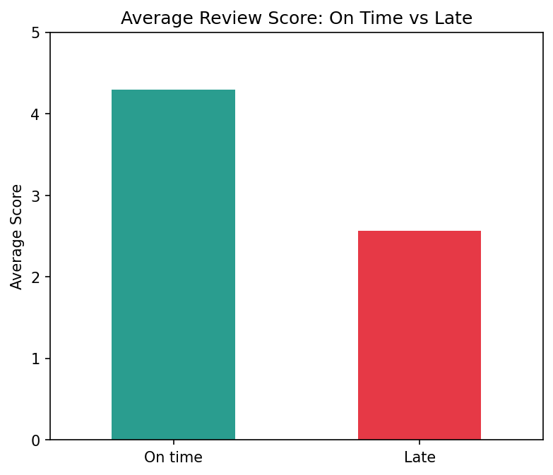
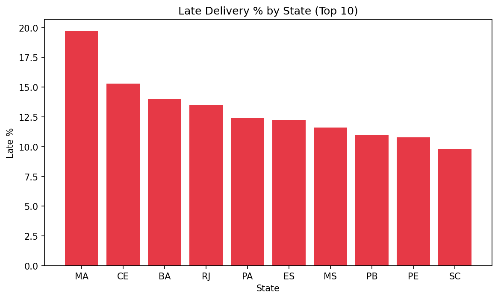
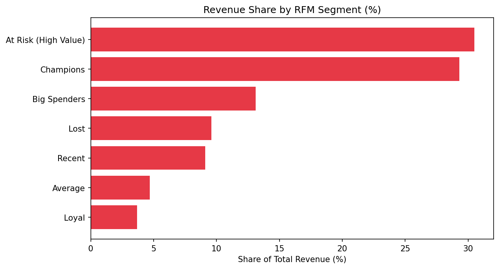
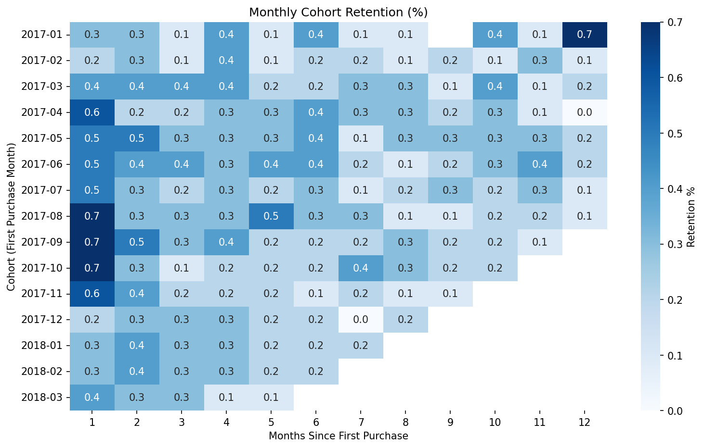

# Olist E-Commerce Analysis: Late Deliveries, Customer Segments and Retention

An end-to-end analysis of ~100K real orders from [Olist](https://www.kaggle.com/datasets/olistbr/brazilian-ecommerce), a Brazilian online marketplace (2016–2018). The goal is not just to chart the data, but to answer business questions and turn the answers into recommendations.

## Key Findings

1. **Late delivery is strongly linked to bad reviews.** Late orders averaged **2.57** stars vs **4.29** for on-time orders. The share of 1-star reviews jumped from **6.6% to 46.2%**.
2. **Rio de Janeiro (RJ) is the biggest improvement opportunity.** It has a similar order volume to Minas Gerais (MG) but a late rate of **13.5% vs 5.6%**.
3. **Revenue is concentrated in a small group of customers.** The "At Risk (High Value)" and "Champions" segments are about 31% of customers but about **60% of revenue**.
4. **Almost nobody comes back.** **97%** of customers bought only once, and only **~0.46%** of new customers buy again in the following month.

## Business Questions

- Does late delivery hurt customer satisfaction, and where is the problem worst?
- Who are the most valuable customers, and which of them are we losing?
- Do customers come back after their first purchase?

## Data

- Source: [Brazilian E-Commerce Public Dataset by Olist (Kaggle)](https://www.kaggle.com/datasets/olistbr/brazilian-ecommerce)
- Tables used: `orders`, `order_items`, `customers`, `order_reviews`
- Size: 99,441 orders; 96,470 delivered orders with a delivery date; 93,350 unique customers
- The raw data is not included in this repo (see "How to Run").

## Methodology

1. **Cleaning:** converted date columns, kept `delivered` orders only (97% of all orders), removed 8 delivered orders with no delivery date, kept the latest review per order, and aggregated `order_items` per order *before* joining to avoid duplicated rows.
2. **Delivery analysis:** computed `delivery_days` and `is_late` (delivered after the estimated date), then compared review scores and late rates by customer state.
3. **RFM segmentation:** Recency and Monetary scored 1–5 with quantiles; Frequency capped at 3 because 97% of customers have a single order. Segments are defined by simple rules on R, F and M.
4. **Cohort retention:** grouped customers by month of first purchase and tracked the share who purchased again in later months (cohorts from 2017-01 to 2018-03).

## Results

### 1. Late delivery vs review score

| | Avg review score | 1-star | 5-star |
|---|---|---|---|
| On time | 4.29 | 6.6% | 62.4% |
| Late | 2.57 | 46.2% | 22.2% |

- 8.1% of delivered orders arrive late. Median delivery time is 10 days (mean 12.1).
- Across states with 500+ orders, late rate and average review score have a correlation of **-0.86**.



### 2. Late deliveries by state

- **MA** has the highest late rate (19.7%) but a small volume (717 orders).
- **SP** has the most late orders in absolute terms (2,389) but a low late rate (5.9%) because of its size.
- **RJ** combines high volume (12,350 orders) with a 13.5% late rate (1,667 late orders).



### 3. RFM segments

| Segment | Customers | Revenue share |
|---|---|---|
| At Risk (High Value) | 14,462 | 30.5% |
| Champions | 14,517 | 29.3% |
| Big Spenders | 6,943 | 13.1% |
| Lost | 22,752 | 9.6% |
| Recent | 21,701 | 9.1% |
| Average | 11,162 | 4.7% |
| Loyal | 1,813 | 3.7% |



### 4. Cohort retention

Average retention after 1, 3 and 6 months is **0.46%, 0.25% and 0.26%**, and it does not improve in newer cohorts.



## Recommendations

- **Fix delivery in RJ first.** Bringing RJ's late rate closer to MG's (~6%) would remove roughly 900 late orders (rough estimate: 12,350 × (13.5% − 6%)).
- **Run a win-back campaign for "At Risk (High Value)".** They represent ~30% of revenue and have not purchased in over a year on average.
- **Protect Champions** with a loyalty program and encourage repeat purchases.
- **Push a second purchase early** for "Recent" customers, before they become "Lost".
- **Do not overspend on "Lost" customers:** many customers, but low value per customer.

## Limitations

- RFM segments are based on rules I defined, so they are an approximate prioritization, not exact truth. Changing the thresholds changes the numbers.
- The link between late delivery and low reviews is a strong association, not proof of cause. Product quality and other factors may also play a role.
- "At Risk" is a hypothesis: we do not know that these customers would respond to a win-back offer without a real experiment (A/B test).
- Retention numbers are very small, so differences between monthly cohorts are likely noise and are not interpreted.
- Revenue means the sum of item prices and excludes shipping.
- 646 delivered orders have no review and are excluded from review-based metrics.
- Olist is a marketplace with many sellers, and many products (furniture, electronics) are rarely bought repeatedly, which may explain part of the low retention.

## Project Structure

```
olist-ecommerce-analysis/
├── data/              # raw CSVs (not tracked by Git)
├── notebooks/
│   ├── 01_cleaning.ipynb          # cleaning, delivery vs reviews, state analysis
│   ├── 03_rfm.ipynb               # RFM segmentation
│   └── 05_cohort_retention.ipynb  # cohort retention
├── app/               # Streamlit dashboard (coming soon)
├── images/            # charts used in this README
├── requirements.txt
└── README.md
```

## How to Run

1. Clone the repo and install the requirements:
   ```bash
   pip install -r requirements.txt
   ```
2. Download the dataset from [Kaggle](https://www.kaggle.com/datasets/olistbr/brazilian-ecommerce) and put the CSV files in `data/`.
3. Run the notebooks in order: `01_cleaning` first (it creates `data/clean_orders.csv`), then `03_rfm` and `05_cohort_retention`.

## Tools

Python, Pandas, Matplotlib, Seaborn, Jupyter Notebook

## Dashboard

Coming soon (Streamlit).
